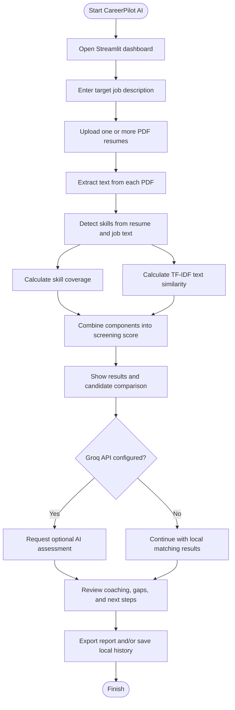

# CareerPilot AI — Resume Intelligence & Career Skill-Gap Dashboard

> **CareerPilot AI** is a local-first, Streamlit-based prototype that helps users compare PDF resumes with a target job description, understand detected skill matches and gaps, review explainable screening scores, and plan next learning steps.

It is designed as a hackathon project and decision-support tool. It does **not** predict hiring success, replace human review, or guarantee that a candidate has or lacks a skill.

---

## Table of Contents

1. [Project at a Glance](#-project-at-a-glance)
2. [Problem Statement](#-problem-statement)
3. [Project Goals](#-project-goals)
4. [Features](#-features)
5. [Application Workflow](#-application-workflow)
6. [Scoring Methodology](#-scoring-methodology)
7. [AI Automation and Intelligence](#-ai-automation-and-intelligence)
8. [Dashboard and User Interface](#-dashboard-and-user-interface)
9. [Project Structure](#-project-structure)
10. [Technology Stack](#-technology-stack)
11. [Installation on Windows](#-installation-on-windows)
12. [Environment Configuration](#-environment-configuration)
13. [Running the Application](#-running-the-application)
14. [How to Use CareerPilot AI](#-how-to-use-careerpilot-ai)
15. [Reports, Exports, and Local History](#-reports-exports-and-local-history)
16. [Privacy and Responsible Use](#-privacy-and-responsible-use)
17. [Current Limitations](#-current-limitations)
18. [Troubleshooting](#-troubleshooting)
19. [Future Improvements](#-future-improvements)
20. [Contributing](#-contributing)
21. [License](#-license)

---

## 🚀 Project at a Glance

| Item | Description |
|---|---|
| Project name | CareerPilot AI |
| Application type | Interactive web dashboard |
| Interface framework | Streamlit |
| Main input | Text-based PDF resume(s) and a job description |
| Main output | Screening score, text similarity, detected skills, skill gaps, and candidate comparisons |
| AI integration | Optional Groq API assessment |
| Local persistence | SQLite screening history |
| Export formats | CSV, JSON, and text downloads (depending on report/tool) |
| Intended use | Resume review assistance, skill-gap awareness, interview practice, and learning guidance |
| Project status | Hackathon prototype |

## 🎯 Problem Statement

Applicants and reviewers can find it difficult to connect a resume to the requirements of a specific role. Manually comparing multiple resumes can take time, while a raw similarity score does not explain which skills were detected or what could be improved.

CareerPilot AI brings several review steps into one dashboard:

- compares resume text with a supplied job description;
- identifies skills recognised by its built-in vocabulary;
- calculates a transparent, heuristic screening score;
- highlights detected matches and gaps;
- optionally asks a Groq-powered AI service to provide additional feedback;
- offers interview practice and learning-roadmap tools;
- keeps a local history of screening reports for later review.

The results are intended to support human judgement, not make automatic hiring decisions.

## 💡 Project Goals

- Make resume-to-job-description comparison easier to understand.
- Present screening results in a clear dashboard instead of only raw text.
- Explain the score through visible components.
- Help users inspect detected skill matches and gaps.
- Support batch comparisons when multiple resumes are supplied.
- Keep screening history locally for convenient follow-up.
- Provide optional AI-assisted coaching without making AI a requirement for basic matching.

## ✨ Features

### 1. Dashboard overview

The dashboard brings key screening information into one place, including metrics such as total resumes screened, average screening score, average skill coverage, job profiles, recent scores, and latest reports—where available in the current app state.

### 2. Single-resume and batch screening

Upload one or more text-based PDF resumes and provide a target job description. Batch screening allows multiple candidates to be compared against the same role and displayed in a ranked comparison table.

### 3. Explainable screening score

The score combines detected skill coverage and text similarity using a fixed, documented weighting. See [Scoring Methodology](#-scoring-methodology).

### 4. Skill-match and skill-gap analysis

CareerPilot AI displays skills it recognises in the job description and resume, including matching skills and detected gaps. These results depend on the application's built-in skill vocabulary and the text extracted from the PDF.

### 5. Optional AI Resume Coach

When a Groq API key is configured, the app can request additional feedback such as:

- strengths supported by the provided resume text;
- possible areas for improvement;
- relevant keywords to consider;
- project ideas for skill development;
- a suggested professional summary.

AI output may be incomplete or incorrect. Always check suggestions against the original resume and job description.

### 6. Interview preparation

The Interview Prep feature provides role- and skill-related practice questions and answer-drafting fields, helping users prepare for technical or role-specific discussions.

### 7. Learning roadmap

The Learning Roadmap feature turns detected skill gaps into suggested learning steps. Treat these as guidance rather than a verified course syllabus or guaranteed path to employment.

### 8. Past reports and local history

Screening results can be stored in a local SQLite database, searched later, exported as JSON, and—where enabled in the interface—deleted by the user.

### 9. Downloadable results

Depending on the selected feature, the app supports downloads such as:

- **CSV:** candidate comparison table;
- **JSON:** structured screening report or history export;
- **TXT:** interview-practice or learning-roadmap content.

---

## 🔄 Application Workflow



### Workflow explained

1. **Provide the role:** paste the job description the resume should be compared with.
2. **Upload resumes:** select one or multiple PDF files.
3. **Extract text:** the app reads selectable text from the PDF. Image-only scans are not supported unless OCR is added.
4. **Detect skills:** the app checks extracted text against its built-in skill vocabulary.
5. **Calculate scores:** skill coverage and TF-IDF similarity are combined into a screening score.
6. **Review results:** inspect the score, matching skills, detected gaps, and—when batch screening is used—candidate comparisons.
7. **Use optional AI:** if configured, request additional coaching and recommendations.
8. **Save or export:** use available download controls and local report history.

---

## 🧮 Scoring Methodology

CareerPilot AI uses the following explainable heuristic:

**Screening score = 70% × detected skill coverage + 30% × TF-IDF text similarity**

| Component | Weight | What it measures |
|---|---:|---|
| Detected skill coverage | 70% | The proportion of recognised job-description skills that are also detected in the resume |
| TF-IDF text similarity | 30% | Wording overlap between the resume text and job description, calculated using TF-IDF vectors and cosine similarity |
| Final screening score | 100% | The weighted combination of the two components |

### Important interpretation notes

- **Skill coverage** depends on the built-in vocabulary and the quality of extracted text.
- **Text similarity** measures textual overlap, not a candidate's full ability or potential.
- A low score does not automatically mean a candidate is unsuitable.
- A skill not detected by the app may still be present under a synonym, in a project description, or in a format the parser missed.
- The score is a review aid—not a probability of getting hired and not a prediction of future job performance.
- Always review the original resume and use consistent, job-related criteria.

---

## 🤖 AI Automation and Intelligence

CareerPilot AI combines deterministic local processing with optional external AI assistance.

| Stage | Processing | Output |
|---|---|---|
| PDF input | PDF text extraction | Resume text available for analysis |
| Skill detection | Built-in skill vocabulary matching | Detected resume/job skills |
| Coverage calculation | Compare detected job skills with resume skills | Skill coverage and visible gaps |
| Text comparison | TF-IDF vectorisation and cosine similarity | Text similarity score |
| Score calculation | Weighted formula | Explainable screening score |
| Optional AI assessment | Groq API, when configured | Additional feedback and coaching |
| Report history | Local SQLite database | Saved reports for later review |
| Export | Download generation in the app | CSV, JSON, or TXT files where supported |

### What is automated?

- extracting selectable text from uploaded PDFs;
- detecting recognised skills;
- calculating similarity and weighted scores;
- comparing multiple resumes against a job description;
- presenting result summaries and comparisons;
- generating optional AI feedback;
- saving and exporting screening reports.

### What is not guaranteed to be automated?

- verifying whether a candidate truly possesses a skill;
- validating a qualification or employment history;
- checking whether a job posting is current or authentic;
- verifying that a suggested course, resource, or project is the best available option;
- making a fair or final hiring decision.

**Note on animations:** Streamlit reruns the app as users interact with widgets and can display charts, metrics, tables, and other interactive elements. This README does not claim custom animations or transitions unless they are implemented in the source code.

---

## 📊 Dashboard and User Interface

The app is organised around its available dashboard sections and tools:

| Section / Tool | Purpose |
|---|---|
| Dashboard | Review headline metrics, recent scores, job profiles, and latest reports |
| Batch screening | Compare multiple resumes against one job description |
| Skill-gap analysis | Inspect recognised matching skills and detected gaps |
| Resume Coach | Review strengths, improvement suggestions, keywords, project ideas, and a suggested summary |
| Interview Prep | Practise role-related questions and draft answers |
| Learning Roadmap | Review suggested next steps for detected gaps |
| Past Reports | Search and revisit locally stored screening history |
| Export controls | Download supported results in useful formats |

The exact labels, layout, charts, and controls depend on the version of `app.py` in the repository. This documentation describes the intended functionality and does not assume that unverified animations or UI components exist.

---

## 🗂️ Project Structure

```text
CareerPilot-AI/
├── app.py                  # Streamlit dashboard and application flow
├── analyzer.py             # Resume/job analysis, skill matching, and scoring logic
├── resume_parser.py        # PDF text extraction helpers
├── requirements.txt        # Python package dependencies
├── .env.example            # Example environment-variable configuration
├── .gitignore              # Excludes secrets, virtual environments, and local data
├── README.md               # Project documentation
├── .env                    # Local secrets; do not commit (created locally)
├── .venv/                  # Local Python virtual environment; do not commit
└── careerpilot_history.db  # Local SQLite history; generated/used at runtime
```

> `.env`, `.venv/`, and `careerpilot_history.db` are local runtime files. They should remain excluded from Git. The database may appear after running the application.

### Main files

| File | Responsibility |
|---|---|
| `app.py` | Streamlit pages, widgets, dashboard presentation, user interactions, and report actions |
| `analyzer.py` | Skill detection, text similarity, score calculation, and analysis helpers |
| `resume_parser.py` | Reads text from supported PDF resumes |
| `requirements.txt` | Lists the Python libraries required to run the project |
| `.env.example` | Documents the names of optional environment variables without storing real secrets |
| `.gitignore` | Prevents local secrets, virtual environments, caches, and database files from being committed |
| `careerpilot_history.db` | SQLite database for local screening history |

---

## 🧰 Technology Stack

| Technology | Role in the project |
|---|---|
| Python | Core programming language |
| Streamlit | Interactive dashboard and web interface |
| PDF parsing library listed in `requirements.txt` | Extracts text from PDF resumes |
| scikit-learn | TF-IDF vectorisation and cosine similarity, if used by the current analyzer implementation |
| SQLite | Local screening-history storage |
| Groq API | Optional AI-powered assessment and coaching |
| pandas / Python data tools | Tabular comparisons and exports, if included in the current implementation |
| Git and GitHub | Source control and project hosting |

The exact dependencies are defined by `requirements.txt`. If a library is not listed there or imported by the code, do not assume it is required.

---

## 🪟 Installation on Windows

### Prerequisites

- Windows 10 or Windows 11;
- Python 3.10+ recommended (use a version compatible with the project's dependencies);
- Git, if you plan to clone the repository;
- an internet connection for installing packages;
- an optional Groq API key for AI features.

### Option A — Clone from GitHub

```powershell
git clone https://github.com/ashfaque-ahmed78/CareerPilot-AI.git
cd CareerPilot-AI
```

### Option B — Open your existing project folder

Open PowerShell in the folder that contains `app.py`, `analyzer.py`, and `requirements.txt`.

### Create and activate a virtual environment

```powershell
python -m venv .venv
.\.venv\Scripts\Activate.ps1
```

If PowerShell blocks activation, you can use the environment's Python directly:

```powershell
.\.venv\Scripts\python.exe -m pip install --upgrade pip
.\.venv\Scripts\python.exe -m pip install -r requirements.txt
```

If activation works, continue with:

```powershell
python -m pip install --upgrade pip
python -m pip install -r requirements.txt
```

### Configure environment variables

Create a local `.env` file from the example if your project uses this setup:

```powershell
Copy-Item .env.example .env
notepad .env
```

Add your real key only to the local `.env` file:

```env
GROQ_API_KEY=your_actual_key_here
GROQ_MODEL=openai/gpt-oss-120b
```

Replace the example key with your own key. Never paste a real key into the README, source code, screenshots, public issues, or GitHub commits.

> If `.env` already exists, do not overwrite it with `Copy-Item`. Edit the existing file instead. The application must also load environment variables from `.env` (for example, via `python-dotenv`) for this method to work; check the current code and dependencies if the key is not detected.

---

## ▶️ Running the Application

From the project directory, with the virtual environment activated:

```powershell
python -m streamlit run app.py
```

Or run Streamlit through the virtual environment directly:

```powershell
.\.venv\Scripts\python.exe -m streamlit run app.py
```

Streamlit normally prints a local URL such as `http://localhost:8501`. Open the URL shown in your terminal.

To stop the local server, focus the PowerShell terminal and press **Ctrl + C**.

---

## 🧭 How to Use CareerPilot AI

1. **Start the app** using the command above.
2. **Choose the relevant dashboard tool** from the current interface.
3. **Paste the target job description** into the job-description field.
4. **Upload a text-based PDF resume** (or multiple PDFs for batch screening).
5. **Run the analysis** using the app's available action button.
6. **Review the screening score** and its underlying components.
7. **Inspect matched skills and detected gaps**; compare these with the original resume.
8. **Optionally review AI feedback** if the Groq API key is configured.
9. **Use interview practice and roadmap suggestions** to plan preparation.
10. **Export or revisit the report** using the controls available in the current version.

### Tips for better results

- Use a clear, text-based PDF rather than a scanned image.
- Include a complete, role-specific job description.
- Keep resume content readable and organised.
- Review every detected skill against the source document.
- Treat generated summaries and recommendations as drafts to edit, not facts to copy blindly.

---

## 📁 Reports, Exports, and Local History

### Local history

The app stores screening history in `careerpilot_history.db`, a local SQLite database. This is convenient for a single-user prototype, but it is not a secure, shared production database.

### Export formats

| Format | Typical use |
|---|---|
| CSV | Compare candidates or open results in spreadsheet software |
| JSON | Preserve structured report data or export history |
| TXT | Save interview questions, roadmap notes, or plain-text content |

The exact fields and export options depend on the selected screen and the current implementation.

### Backup and cleanup

- Back up the database only if you need to preserve local history.
- Do not upload resumes or reports containing personal information to a public repository.
- Use the app's history-deletion controls, if present, when you want to remove stored reports.
- Deleting a report from the app does not delete copies already downloaded or backed up elsewhere.

---

## 🔐 Privacy and Responsible Use

- **API key:** keep `GROQ_API_KEY` in a local environment file or deployment secret manager.
- **GitHub:** never commit `.env`, API keys, private resumes, or screening-history databases.
- **External AI:** when AI assessment is enabled, relevant text may be sent to the configured Groq service. Do not submit data unless you have permission and understand the service's applicable data handling terms.
- **Candidate privacy:** obtain permission before processing another person's resume and follow applicable privacy and employment rules.
- **Human review:** do not use the score as the sole basis for rejecting, ranking, or hiring a person.
- **Fairness:** skill vocabularies and text-similarity systems can miss relevant experience, synonyms, non-traditional career paths, and context.
- **Data minimisation:** only upload information needed for the task, and remove local reports when they are no longer needed.

---

## ⚠️ Current Limitations

- OCR for scanned or image-only PDFs is not included.
- The built-in skill vocabulary is limited and may miss synonyms or specialised skills.
- TF-IDF similarity measures text overlap, not meaning or real-world competence.
- AI-generated feedback can be incorrect, incomplete, or overly confident.
- Recommendations should be independently reviewed; the app does not guarantee that learning resources are current or accredited.
- Local SQLite history is intended for a single-user prototype, not a secure multi-user deployment.
- Network access is required for optional Groq AI calls and initial dependency installation.
- This README does not claim custom animations, external job-market verification, multi-user authentication, or progress synchronisation unless those features are confirmed in the current code.

---

## 🛠️ Troubleshooting

### `No module named streamlit`

Install dependencies using the same Python environment used to start the app:

```powershell
python -m pip install -r requirements.txt
python -m streamlit run app.py
```

If you have a virtual environment, confirm it is activated or use:

```powershell
.\.venv\Scripts\python.exe -m pip install -r requirements.txt
.\.venv\Scripts\python.exe -m streamlit run app.py
```

### `Cannot connect to CareerPilot API`

If the interface expects a separate backend service, start that backend in its own terminal and check the API URL configured in the app. If your current version is a Streamlit-only app, it may not require a separate backend; follow the code version you are running.

### Groq AI features do not work

- Confirm the key is named `GROQ_API_KEY`.
- Check that the local `.env` is in the directory expected by the application.
- Verify that the code loads `.env` values and that `python-dotenv` is installed if needed.
- Confirm the API key is valid and the configured model is available to your account.
- Restart Streamlit after changing environment variables.
- Local skill matching should still be available when optional AI is not configured, provided the current code supports the documented fallback.

### PowerShell cannot activate `.venv`

Use the environment's Python executable directly:

```powershell
.\.venv\Scripts\python.exe -m pip install -r requirements.txt
.\.venv\Scripts\python.exe -m streamlit run app.py
```

### Resume text is empty or incomplete

Check whether the PDF contains selectable text. Scanned pages may require OCR, which is not included in the current prototype.

### Git tries to include `.env` or the database

Check `.gitignore` and the staged files before committing:

```powershell
git status
git check-ignore -v .env careerpilot_history.db
```

If a secret has already been committed or pushed, removing it in a later commit is not enough: revoke/rotate the exposed key and clean the Git history before sharing the repository further.

---

## 🗺️ Future Improvements

Potential next steps for the project include:

- expand and maintain the skill vocabulary, including synonyms;
- add OCR support for scanned resumes;
- provide clearer evidence snippets showing where a skill was detected;
- add configurable role profiles and compare a resume with 3–5 career paths;
- connect learning recommendations to verified, up-to-date resources;
- add user-defined milestones and progress tracking;
- improve accessibility, mobile layout, and user feedback;
- add tests for PDF parsing, score calculation, and export functions;
- add authentication, access controls, and secure storage before any multi-user deployment;
- document and validate any animation or transition effects added to the UI.

These are proposed improvements, not claims that they are already implemented.

---

## 🤝 Contributing

Contributions are welcome. A useful contribution workflow is:

1. Fork the repository.
2. Create a feature branch.
3. Make a focused change.
4. Test the affected workflow locally.
5. Update the documentation if behaviour changes.
6. Open a pull request describing the change and how it was tested.

Please do not include real API keys, private resumes, personal candidate data, or local database files in commits.

---

## 📄 License

No license has been specified yet. Unless a license file is added, reuse, modification, and redistribution are not automatically granted. Add a `LICENSE` file if you want to publish the project under an open-source license.
